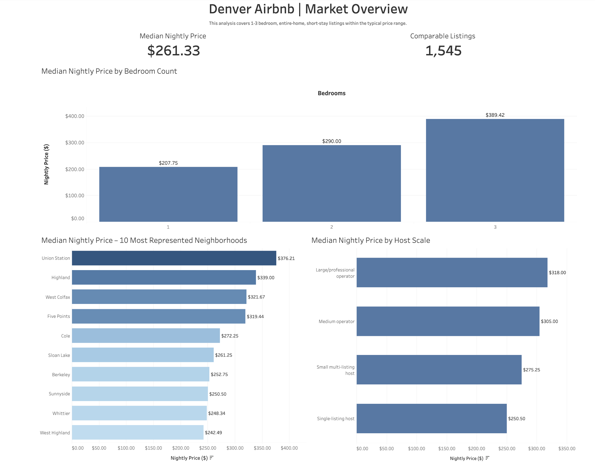
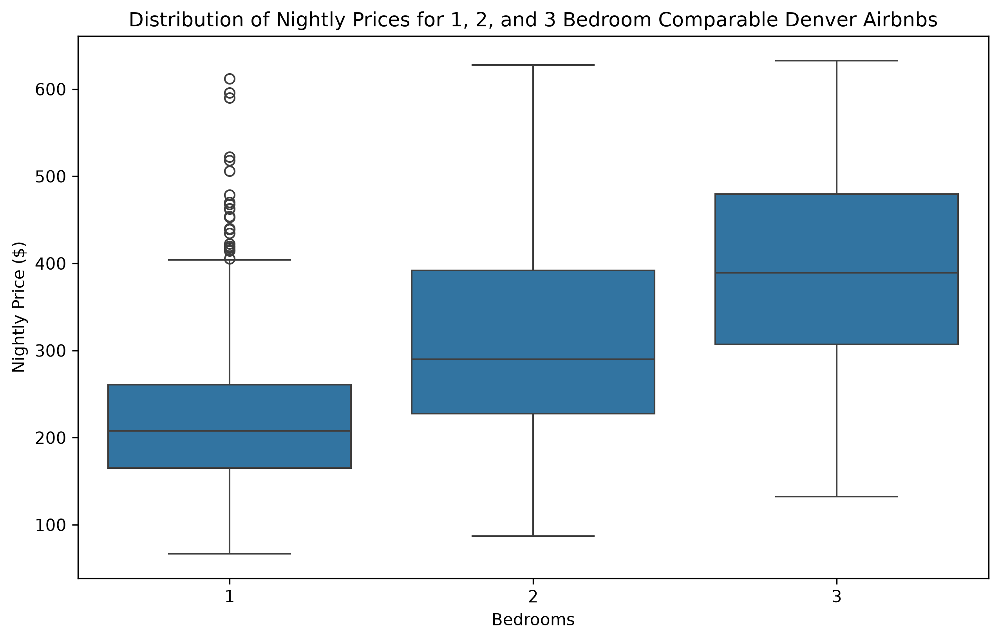
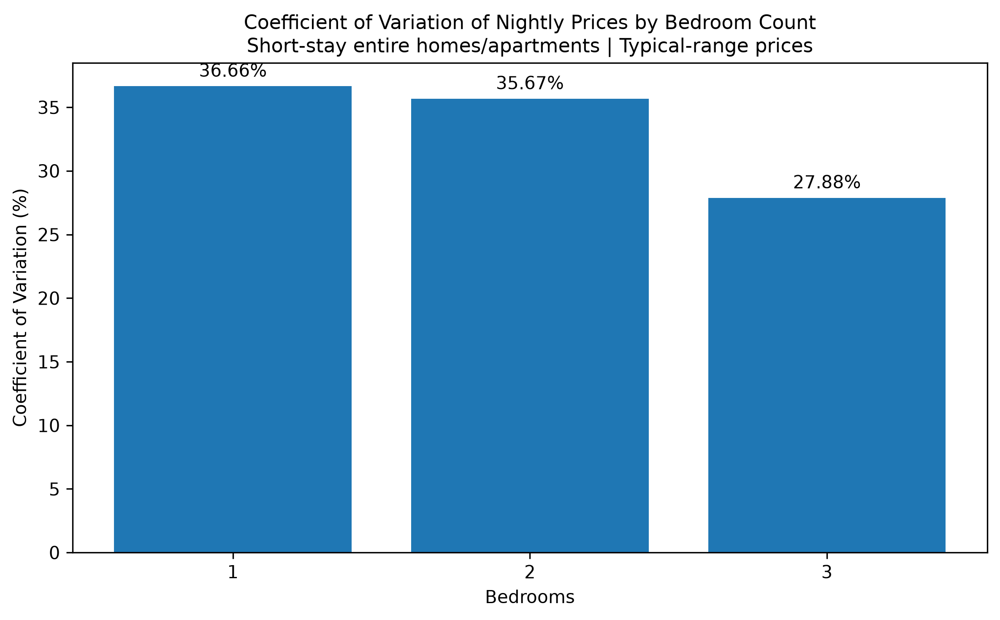
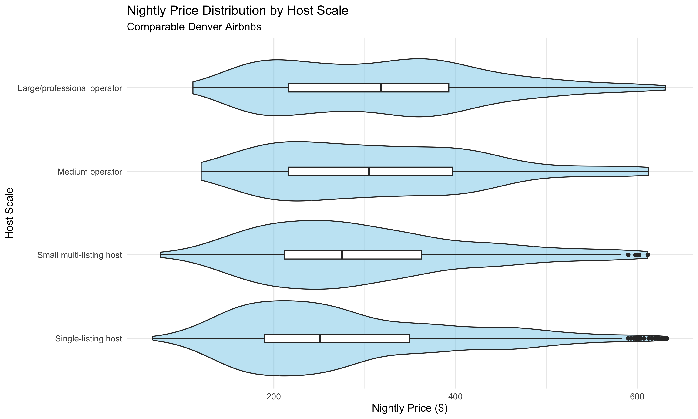
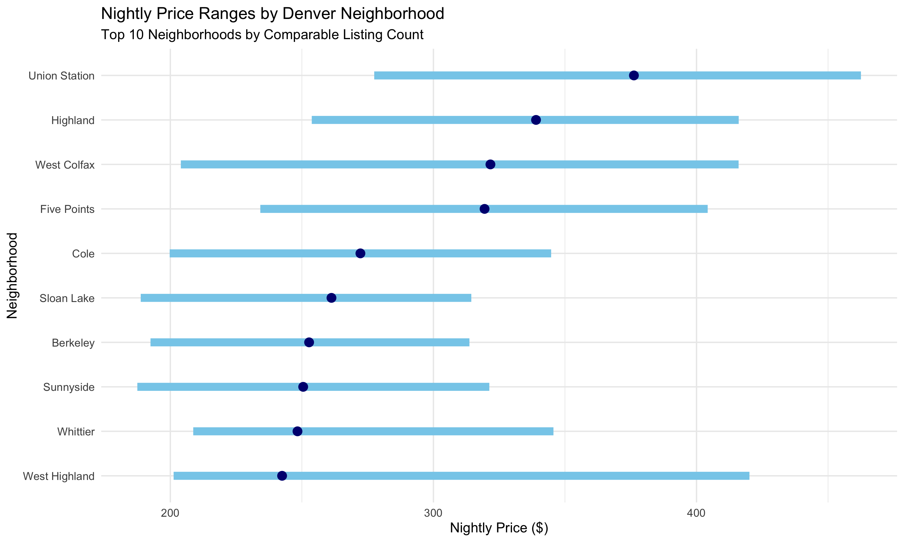

# Denver Airbnb Market Analysis

**Tools:** SQL (DuckDB) | Python | R | Google Sheets | Tableau

An end-to-end analysis of Denver's Airbnb short-term rental market, examining pricing patterns across bedroom counts, neighborhoods, host characteristics, and property attributes.

### Explore the Project

- **[Interactive Tableau Dashboard](https://public.tableau.com/views/DenverAirbnbMarketOverview/DenverAirbnb-MarketOverview)** — Explore the key pricing findings through interactive visualizations.
- **[Google Sheets Analysis](https://docs.google.com/spreadsheets/d/1LTeZ-GVYqrYQ_D5Po2h-DqC42cFs5VMRm8Y553t6OLs/edit?usp=sharing)** — Review spreadsheet analysis, pivot tables, formulas, and charts.
- **[SQL Analysis](sql/02_eda_analysis.sql)** — Examine SQL queries used to investigate market patterns.
- **[Python Analysis](notebooks/02_denver_airbnb_analysis.ipynb)** — Explore Python-based data preparation, validation, and analysis.

### Dashboard Preview



*Interactive dashboard exploring nightly prices across bedroom counts, neighborhoods, and host categories. [View the full dashboard on Tableau Public](https://public.tableau.com/views/DenverAirbnbMarketOverview/DenverAirbnb-MarketOverview).*

### Project at a Glance

| Metric | Value |
|---|---:|
| Total Airbnb listings | 4,939 |
| Calendar records | 1,802,735 |
| Guest reviews | 354,646 |
| Comparable listings | 1,545 |
| Median nightly price (comparable listings) | $261.33 |

### Key Findings at a Glance

- **Bedroom count:** Median nightly prices increased from $207.75 for one-bedroom listings to $389.42 for three-bedroom listings, approximately 87.4% higher.
- **Neighborhood differences:** Union Station had the highest median nightly price ($376.21) among the 10 most represented neighborhoods.
- **Host characteristics:** Large/professional operators had a median nightly price of $318.00, compared with $250.50 for single-listing hosts.

### Project Overview

This project investigates how Airbnb nightly prices vary across Denver's short-term rental market and identifies listing characteristics associated with higher or lower advertised prices.

The analysis follows an end-to-end workflow encompassing data acquisition, profiling, cleaning, exploratory analysis, statistical summaries, spreadsheet analysis, and interactive visualization.

To improve comparability, the primary pricing analysis focuses on **1,545 entire-home or apartment listings** with 1–3 bedrooms, short-stay policies, and nightly prices within the defined typical price range.

The findings provide descriptive market insights that can support competitive pricing research, neighborhood comparisons, and short-term rental market evaluation.

## Business Objectives

The primary objective is to understand how Airbnb nightly prices vary across Denver's short-term rental market and identify characteristics associated with higher or lower listing prices.

The analysis addresses the following questions:

1. **Bedroom Count:** How does median nightly price differ between one-, two-, and three-bedroom properties?
2. **Neighborhood Differences:** Which of Denver's most represented neighborhoods have higher or lower median nightly prices?
3. **Host Characteristics:** How do nightly prices vary between single-listing hosts, small multi-listing hosts, medium operators, and large or professional operators?
4. **Listing Characteristics:** What relationships exist between property amenities, listing attributes, and nightly prices?
5. **Market Comparability:** How can filtering and data-quality controls improve the reliability of comparisons between Airbnb listings?

The findings are intended to provide descriptive market insights that could support pricing research, competitive benchmarking, and short-term rental market evaluation.

## Data Sources

The project uses three datasets covering Airbnb listings, calendar availability, and guest reviews in Denver, Colorado.

| Dataset | Records | Description |
|---|---:|---|
| Listings | 4,939 | Property characteristics, location, host information, nightly prices, amenities, and review metrics |
| Calendar | 1,802,735 | Date-level availability information for individual listings |
| Reviews | 354,646 | Guest review records associated with individual listings |

### Dataset Relationships

The datasets are connected through the Airbnb listing identifier.

- **Listings:** One record per listing, identified by `id`.
- **Calendar:** Multiple date-level records per listing, linked through `listing_id`.
- **Reviews:** Multiple review records per listing, linked through `listing_id`.

These relationships allow listing characteristics to be examined alongside calendar availability and guest review activity.

### Data Preparation and Quality Controls

The data preparation process included:

- Profiling dataset structures, data types, missing values, and record counts.
- Checking listing identifiers and relationships between datasets.
- Converting nightly price values into numeric fields suitable for analysis.
- Examining missing prices, unusual values, and other potential data-quality issues.
- Standardizing analytical fields and developing derived listing classifications.
- Defining a comparable-listing population for more consistent pricing comparisons.

Of the 4,939 listings, 688 had missing nightly prices and were excluded from analyses requiring valid price data.

Cleaned datasets were exported for downstream analysis and visualization.

## Tools & Technologies

| Technology | Application in the Project |
|---|---|
| **SQL / DuckDB** | Data cleaning, joins, aggregations, exploratory analysis, and analytical queries |
| **Python** | Dataset profiling, data preparation, quality validation, and reproducible analysis workflows |
| **R / ggplot2** | Statistical summaries, distribution analysis, and exploratory visualizations |
| **Google Sheets** | Spreadsheet formulas, lookup functions, pivot tables, and comparative analysis |
| **Tableau Public** | Interactive dashboard development, KPI reporting, and visualization publishing |
| **VS Code** | Development environment for managing project files, scripts, and documentation |

### Analytical Workflow

The project followed a structured sequence:

1. **Data Acquisition:** Obtain and inspect the Denver Airbnb datasets.
2. **Data Understanding:** Examine dataset structures, relationships, and analytical granularity.
3. **Data Quality Assessment:** Identify missing values, inconsistent fields, and potential analytical limitations.
4. **Data Cleaning and Modeling:** Prepare standardized datasets and define derived variables.
5. **SQL Analysis:** Investigate pricing, availability, host characteristics, and neighborhood patterns.
6. **Python Analysis:** Perform programmatic profiling, cleaning, and validation.
7. **R Analysis:** Generate statistical summaries and exploratory visualizations.
8. **Spreadsheet Analysis:** Apply formulas, pivot tables, and charting techniques.
9. **Tableau Visualization:** Develop and publish a market overview dashboard.
10. **Project Documentation:** Consolidate methodology, findings, limitations, and deliverables for portfolio presentation.

## Key Findings and Business Insights

### 1. Nightly Prices Increase with Bedroom Count

Among the 1,545 comparable listings, median nightly prices increased consistently with the number of bedrooms.

| Bedrooms | Listings | Median Nightly Price |
|---|---:|---:|
| 1 Bedroom | 706 | $207.75 |
| 2 Bedrooms | 557 | $290.00 |
| 3 Bedrooms | 282 | $389.42 |

**Key insights:**

- Two-bedroom listings had a median nightly price approximately 39.6% higher than one-bedroom listings.
- Three-bedroom listings had a median nightly price approximately 34.3% higher than two-bedroom listings.
- Three-bedroom listings had a median nightly price approximately 87.4% higher than one-bedroom listings.

**Business implication:** Bedroom count is an important characteristic to account for when comparing nightly prices. Competitive pricing benchmarks should distinguish properties by bedroom count rather than rely exclusively on market-wide averages.

### 2. Nightly Prices Vary Across Denver Neighborhoods

Among the 10 most represented neighborhoods in the comparable-listing population, median nightly prices differed substantially.

| Neighborhood | Median Nightly Price |
|---|---:|
| Union Station | $376.21 |
| Highland | $339.00 |
| West Colfax | $321.67 |
| Five Points | $319.44 |
| Cole | $272.25 |
| Sloan Lake | $261.25 |
| Berkeley | $252.75 |
| Sunnyside | $250.50 |
| Whittier | $248.34 |
| West Highland | $242.49 |

**Key insights:**

- Union Station had the highest median nightly price among these 10 neighborhoods.
- West Highland had the lowest median nightly price within the same group.
- The difference between the highest and lowest neighborhood medians was approximately $133.72, or 55.1% relative to West Highland.

**Business implication:** Geographic location is an important consideration for pricing comparisons. Neighborhood-level benchmarks can provide more relevant context than a single citywide price statistic.

These results describe the 10 most represented neighborhoods in the comparable-listing subset, not necessarily the 10 most expensive neighborhoods in Denver.

### 3. Nightly Prices Differ by Host Scale

The analysis also compared median nightly prices across host categories.

| Host Category | Median Nightly Price |
|---|---:|
| Large/professional operator | $318.00 |
| Medium operator | $305.00 |
| Small multi-listing host | $275.25 |
| Single-listing host | $250.50 |

**Key insights:**

- Large/professional operators had the highest median nightly price.
- Single-listing hosts had the lowest median nightly price.
- The median price difference between these groups was $67.50, approximately 26.9% relative to single-listing hosts.

**Business implication:** Host scale is associated with differences in advertised nightly prices. However, these differences should not be interpreted as evidence that operating more listings directly causes higher prices. Property size, neighborhood, amenities, and other listing characteristics may contribute to the observed variation.

### 4. Comparable-Listing Filters Improve Market Benchmarking

The primary pricing analysis used a defined subset of 1,545 listings rather than the complete dataset of 4,939 listings.

The comparable-listing criteria restricted the analysis to entire homes or apartments with 1–3 bedrooms, short-stay policies, and prices within the defined typical range.

**Business implication:** Applying consistent selection criteria reduces some sources of variation between fundamentally different property types and makes descriptive pricing comparisons more interpretable.

However, properties within the comparable subset can still differ in location, quality, capacity, amenities, and other characteristics.

### Overall Conclusion

The analysis identified meaningful variation in advertised Airbnb nightly prices across bedroom counts, neighborhoods, and host categories in Denver.

Bedroom count showed a clear positive relationship with median nightly price, while geographic location and host scale provided additional dimensions for market comparison.

These findings support the use of segmented pricing benchmarks rather than relying on a single market-wide figure. They are descriptive associations and should not be interpreted as causal estimates or predictions of future rental performance.

## Additional Exploratory Analysis

Beyond the interactive Tableau dashboard, Python and R were used to investigate price distributions, relative variability, and differences across listing characteristics. These visualizations provide additional statistical context for the primary market findings.

### Nightly Price Distributions by Bedroom Count (Python)



Box plots illustrate how nightly price distributions differ across one-, two-, and three-bedroom comparable listings. In addition to higher median prices for larger properties, the plots highlight differences in price dispersion and the presence of unusually high-priced listings within each bedroom category.

### Relative Price Variability by Bedroom Count (Python)



The coefficient of variation measures price dispersion relative to the mean. One-bedroom listings had a coefficient of variation of **36.66%**, compared with **35.67%** for two-bedroom listings and **27.88%** for three-bedroom listings. These results suggest that three-bedroom listings exhibited less relative price variability within the comparable-listing subset.

### Nightly Price Distributions by Host Scale (R)



Violin plots compare nightly price distributions across host categories, from single-listing hosts to large or professional operators. The distributions illustrate differences in typical prices, overall dispersion, and the extent of overlap between host groups.

### Neighborhood Nightly Price Ranges (R)



This visualization compares price ranges and median nightly prices across the ten neighborhoods with the highest comparable-listing counts. It demonstrates that neighborhoods with similar median prices may exhibit substantially different price ranges, emphasizing the importance of examining variability alongside central tendency.

These findings are descriptive and should not be interpreted as evidence that bedroom count, host scale, or neighborhood independently causes differences in nightly prices. The underlying Python notebooks, R scripts, and additional visualizations are available in the repository.

## Methodology and Limitations

### Analytical Methodology

The analysis primarily uses descriptive statistics, including medians, averages, counts, quartiles, and grouped comparisons.

Median nightly price was emphasized in the primary market analysis because it provides a useful measure of typical listing prices while reducing the influence of unusually expensive properties.

A comparable-listing subset was defined to support more consistent comparisons across bedroom counts, neighborhoods, and host categories.

The analysis is exploratory and descriptive rather than causal or predictive.

### Comparable-Listing Selection and Price Outlier Treatment

The primary pricing analysis focuses on a comparable subset of **1,545 Airbnb listings** selected using four criteria:

- **Property type:** Entire homes or apartments (`room_type = 'Entire home/apt'`).
- **Bedroom count:** Properties with 1–3 bedrooms, inclusive.
- **Stay policy:** Short-stay listings requiring a minimum stay of six nights or fewer (`minimum_nights <= 6`).
- **Price classification:** Listings with valid nightly prices classified as `Typical range`.

To classify nightly prices, the cleaning process first converted currency-formatted price strings into numeric values. The interquartile range (IQR) method was then applied separately to each room type.

The IQR was calculated as `Q3 - Q1`, with outlier boundaries defined as:

- **Lower bound:** `Q1 - 1.5 × IQR`
- **Upper bound:** `Q3 + 1.5 × IQR`

Listings with nightly prices outside these boundaries were classified as price outliers. Listings within the boundaries were classified as `Typical range`.

These filters improve the comparability of descriptive pricing benchmarks but do not control for every difference in property location, quality, amenities, or guest capacity.

### Limitations

**1. Advertised Prices vs. Actual Revenue**

Nightly prices represent listing-level advertised prices rather than confirmed transaction prices. Actual booking prices may differ due to discounts, seasonal adjustments, cleaning fees, taxes, and other charges.

Therefore, the pricing analysis should not be interpreted as a direct measure of realized rental revenue.

**2. Calendar Availability vs. Occupancy**

Unavailable calendar dates do not necessarily represent completed reservations. Dates may be blocked by hosts, restricted by booking policies, or otherwise unavailable.

Consequently, availability-based occupancy estimates should be treated as proxies rather than verified occupancy rates.

**3. Missing Price Data**

Of the 4,939 listings, 688 had missing nightly prices. These records could not contribute to analyses requiring valid price values.

If missing prices are systematically associated with particular property or host characteristics, excluding these records could introduce selection bias.

**4. Comparable-Listing Selection**

The primary analysis focused on 1,545 comparable listings meeting defined property, bedroom, stay-policy, and price-range criteria.

These filters improve comparability but also limit the extent to which findings can be generalized to Denver's entire Airbnb market.

**5. Observational Data**

The observed relationships between nightly prices and listing characteristics do not establish causation.

Differences across bedrooms, neighborhoods, and host categories may reflect additional factors that were not fully controlled for, including property quality, location, amenities, and guest capacity.

**6. Dataset Timeframe**

The analysis represents the market conditions captured by the source data. Findings should not be assumed to reflect current market conditions without obtaining updated listings and calendar data.

## Tableau Dashboard

The project includes a published Tableau dashboard titled **Denver Airbnb | Market Overview**.

The dashboard presents:

- Median nightly price for comparable listings
- Total number of comparable listings
- Median nightly price by bedroom count
- Median nightly price across the 10 most represented neighborhoods
- Median nightly price by host scale

The dashboard uses the same comparable-listing criteria as the primary pricing analysis.

**View the interactive dashboard:** [Denver Airbnb | Market Overview](https://public.tableau.com/views/DenverAirbnbMarketOverview/DenverAirbnb-MarketOverview?:language=en-US&:sid=&:redirect=auth&:display_count=n&:origin=viz_share_link)

## Repository Structure

The repository is organized by analytical tool and project stage. It includes the source code, exploratory notebooks, statistical summaries, visualizations, and documentation produced throughout the analysis.

```text
Denver-Airbnb-Analysis/
│
├── Datalab Workbooks/
│   ├── Denver Airbnb Analysis - Introduction and Data Profiling/
│   ├── Denver Airbnb Analysis - Data Profiling Pt 2/
│   ├── Denver Airbnb Analysis - Analytical Data Preparation/
│   └── Denver Airbnb Analysis SQL EDA/
│
├── data/
│   └── (Raw datasets stored locally; excluded from GitHub)
│
├── notebooks/
│   ├── 01_python_fundamentals.ipynb
│   └── 02_denver_airbnb_analysis.ipynb
│
├── outputs/
│   ├── r_bedroom_summary.csv
│   ├── r_neighborhood_summary.csv
│   ├── r_host_summary.csv
│   ├── r_host_review_summary.csv
│   └── (Python and R visualization PNGs)
│
├── r/
│   └── 01_denver_airbnb_analysis.R
│
├── sheets/
│   ├── charts/
│   └── denver_airbnb_market_analysis.xlsx
│
├── sql/
│   ├── 01_cleaning.sql
│   └── 02_eda_analysis.sql
│
├── tableau/
│   └── denver_airbnb_dashboard.twbx
│
├── .gitignore
├── README.md
├── requirements.txt
└── SQL_EDA_Findings.md
```

### Data Availability

The original Airbnb datasets, local DuckDB database, and large cleaned CSV exports are excluded from the GitHub repository to avoid unnecessary storage and file-size limitations.

The repository retains the analytical code, documented methodology, summary tables, visualizations, and final reporting deliverables.

The SQL, Python, and R files document the transformations and analyses performed using the source datasets. Reproducing the complete workflow requires obtaining the corresponding source data and configuring the local environment.

### Getting Started

To explore the project:

1. Clone the repository using `git clone https://github.com/andyzhang0/Denver-Airbnb-Analysis.git`.
2. Review `README.md` and `SQL_EDA_Findings.md` for the analytical objectives, methodology, and findings.
3. Explore the SQL scripts in `sql/`, Python notebooks in `notebooks/`, and R analysis in `r/`.
4. Install the Python dependencies listed in `requirements.txt` if running the local notebooks.
5. Obtain the corresponding source datasets and configure the local DuckDB environment before attempting to reproduce the full data preparation and analysis workflow.

The published Tableau dashboard and linked Google Sheets workbook can be explored independently without running the local analysis code.

### Navigating the Project

- **Datalab Workbooks:** Original exploratory notebooks covering data profiling, analytical preparation, and SQL exploratory analysis, including supporting images.
- **notebooks:** Python practice and analytical workflows developed locally.
- **sql:** SQL scripts used for data cleaning and exploratory analysis.
- **r:** Statistical analysis and visualization code.
- **outputs:** Analytical summary tables and exported visualizations.
- **sheets:** Spreadsheet-based market analysis using formulas, pivot tables, and charts. The repository includes an exported Excel workbook and chart images. The original analysis is also available in [Google Sheets](https://docs.google.com/spreadsheets/d/1LTeZ-GVYqrYQ_D5Po2h-DqC42cFs5VMRm8Y553t6OLs/edit?usp=sharing).
- **tableau:** Final Tableau packaged workbook, with the published dashboard accessible through Tableau Public.
- **SQL_EDA_Findings.md:** Supporting documentation of SQL exploratory analysis findings.

## Project Deliverables

The project produces the following deliverables:

- Cleaned analytical datasets and documented data-quality decisions
- SQL scripts for cleaning and exploratory analysis
- Python notebooks for data preparation and analysis
- R scripts and statistical visualizations
- Google Sheets analysis and charts
- Published Tableau market overview dashboard
- Documentation of findings, methodology, and analytical limitations

Together, these deliverables demonstrate an end-to-end analytics workflow, from raw data exploration through business-focused visualization and reporting. 